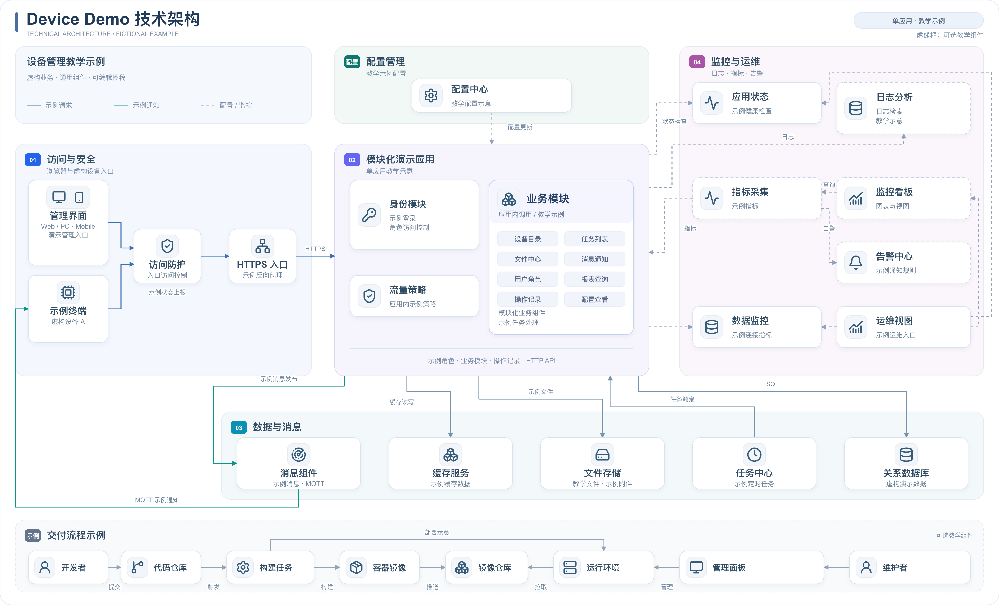
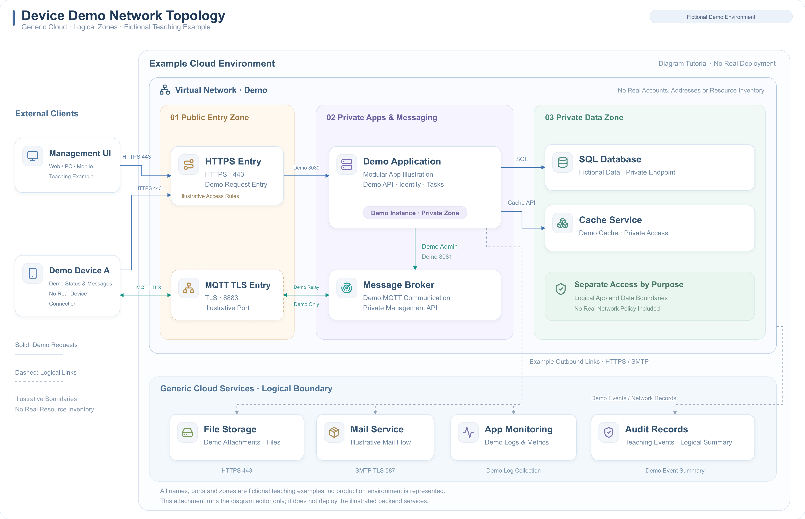
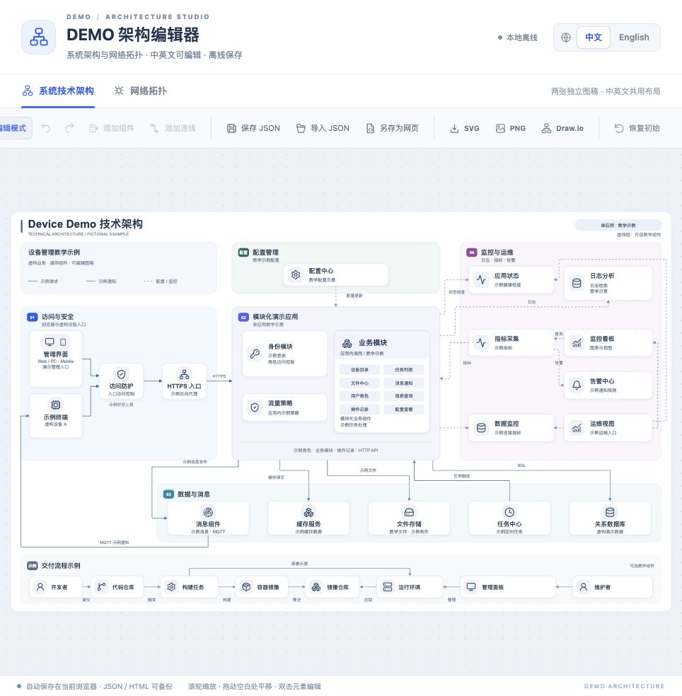

# 用原生 HTML + SVG 做一个离线双语架构图编辑器：从实际操作到静态测试

架构图交付后，经常还要改模块名称、增加一个组件、调整连线，或者提供英文版本。如果只交付一张图片，下一次修改还得找到源文件；如果中英文各维护一份图，又容易出现布局和内容不一致。

本文做一个可以直接打开的网页工具：把系统技术架构和网络拓扑放进同一个编辑器，用一份几何数据维护布局，用两份语言词典维护文字，再提供 JSON、独立 HTML 和图片导出。

配套示例为完全虚构的 **Device Demo**。业务名称、设备、网络分区和端口均用于教学，不对应真实客户或生产环境。附件运行的是绘图编辑器，图中的应用、数据库和消息服务不会随网页一起启动。

## 1. 先看效果与功能

系统图按照访问入口、应用模块、数据与消息、监控运维、交付流程划分区域。网络图强调外部访问、公共入口、私有应用区、私有数据区和通用云服务之间的逻辑关系。





编辑器提供以下操作：

- 在“系统技术架构”和“网络拓扑”之间切换。
- 在“中文”和“English”之间切换，分别维护两种语言的文字。
- 编辑组件、分区、标注、标题和连线；调整位置、尺寸、图标和配色。
- 拖动组件，修改连线端点、连接方位和正交拐点。
- 撤销、重做，保存或导入 JSON，另存为可继续编辑的独立 HTML。
- 导出当前图稿、当前语言的 PNG、SVG 和 Draw.io 文件。

两张图各自维护内容。中英文共用位置、尺寸和连线，文字独立保存。

## 2. 下载后怎样运行

将配套文件包解压到一个目录，直接用桌面浏览器打开 `demo/index.html`。编辑器的样式、脚本、图标和默认数据都在这个文件里，正常使用不需要安装 Node.js，也不需要登录在线服务。

目录中几个常用文件如下：

```text
Architecture_Studio_CSDN/
├── CSDN博客正文.md
├── README.md
├── 发布说明.md
├── demo/
│   ├── index.html                 # 直接打开的网页
│   ├── diagram-project.json       # 默认双语双图数据
│   ├── source/                    # HTML、CSS、JavaScript 与重建脚本
│   └── licenses/                  # 通用图标许可
├── examples/
│   ├── 01-bilingual-edit.json     # 可直接导入的编辑示例
│   ├── customize_project.py       # 按脚本修改图稿的例子
│   └── 02-customized-project.json # 脚本生成的完整项目
├── images/                       # 四组中英文 PNG / SVG / Draw.io
├── tests/                        # 静态检查、负例与离线功能测试
├── reports/                      # 本次实际执行结果
├── package.json
└── package-lock.json
```

运行静态检查和源码重建需要 Python 3.10 或更新版本；扩展离线功能测试需要 Node.js 20.9 或更新版本。后面的命令均在解压后的文件包根目录执行。Windows 的 Python 命令如果是 `py`，可将文中的 `python3` 替换为 `py`。

## 3. 实操一：完成一次双语编辑和恢复

先用默认的“系统技术架构”练习。

1. 开启“编辑模式”，单击左侧“管理界面”，在右侧把名称改成“运营工作台”，点击“应用更改”。
2. 切换到 `English`，选中同一个组件，把名称改成 `Operations UI` 并应用。
3. 将组件向右拖动一小段，再切回中文。应看到中文名称仍为“运营工作台”，组件位置与英文版一致。
4. 点击“保存 JSON”。随后再随意改一个名称，用“导入 JSON”载入刚保存的文件，确认修改恢复。
5. 点击“另存为网页”，打开下载的 HTML，确认两张图和两种语言的内容都在。
6. 切换到“网络拓扑”，确认其内容独立保存；再分别导出 PNG 和 SVG。

也可以直接导入 `examples/01-bilingual-edit.json`，观察“运营工作台 / Operations UI”这组双语修改。

编辑框中尚未点击“应用更改”的内容作为草稿保留。导出图片前先应用更改，避免把草稿误认为已进入图稿。

浏览器对本地文件的存储行为可能不同，不能把自动保存当成唯一备份。MDN 对 `file:` URL 下 `localStorage` 的行为也明确保留了实现差异。这里提供 JSON 和独立 HTML 两种可携带的备份方式。[localStorage 官方说明](https://developer.mozilla.org/en-US/docs/Web/API/Window/localStorage)

## 4. 实操二：增加组件并整理连线

以“网络拓扑”为例，新增一个报表组件。

1. 开启编辑模式，点击“添加组件”，将中文名设为“报表组件”并应用；切换到 English，选中同一组件，将名称设为 `Reports` 并应用，再切回中文。
2. 在画布空白位置放置组件。可以先将位置设为 `x=800, y=790`，宽高设为 `240 × 90`，再按实际布局微调。
3. 点击“添加连线”，将起点设为“演示业务应用”，终点设为新组件，中文标签设为“报表查询”，点击“应用更改”。
4. 选择右侧或底部出线、左侧或顶部入线，先使用正交走线；需要绕开组件时再设置手动拐点。
5. 切换到英文，选中同一连线，将标签改为 `Report Query` 并应用，最后保存 JSON。

手动拐点每行填写一组坐标，例如：

```text
1230, 620
1230, 790
920, 790
```

这些坐标用于理解输入格式，使用时需要结合自己的起终点调整。编辑器提供正交走线和手动绕行，并未实现复杂场景下的全局自动避障；新增组件后仍应检查连线是否穿过卡片、标签是否重叠。

## 5. 数据怎样同时支撑两种语言

项目 JSON 包含两张图，`active` 表示当前图稿，`locale` 表示当前语言。节点和分区保存几何信息，`translations` 保存两种语言的文案。

下面是从示例中抽取的节点及翻译片段。它用于说明结构；实际导入请使用附件里的完整项目 JSON。

```json
{
  "id": "manager",
  "x": 55,
  "y": 350,
  "w": 155,
  "h": 165,
  "name": "管理界面",
  "sub": "Web / PC · Mobile\n演示管理入口",
  "icon": "monitor",
  "layout": "stacked"
}
```

```json
{
  "zh-CN": {
    "node.manager.name": "管理界面",
    "node.manager.sub": "Web / PC · Mobile\n演示管理入口"
  },
  "en": {
    "node.manager.name": "Management UI",
    "node.manager.sub": "Web / PC · Mobile\nDemo Management"
  }
}
```

这里有三个约定。

第一，`id` 是稳定标识，连线和翻译键通过它引用组件。修改显示名称时不需要修改 `id`。

第二，`x/y/w/h` 只有一份，因此中英文布局保持同步。如果英文太长，应缩短文案或扩大组件，并检查中文版的效果。

第三，模块列表是字符串数组。把 `node.business.modules` 的翻译值误写成字符串，会被检查器拒绝，避免出现“中文正常、英文列表异常”的情况。

下面这个可直接运行的脚本，演示如何在网页之外批量修改数据。附件中同样提供了此脚本。

```python
import json
from pathlib import Path

root = Path(__file__).resolve().parents[1]
project = json.loads((root / "demo/diagram-project.json").read_text(encoding="utf-8"))
diagram = project["diagrams"]["system"]
node = next(n for n in diagram["nodes"] if n["id"] == "manager")

node["name"] = "运营工作台"
node["x"] += 15
node["y"] += 5
diagram["translations"]["zh-CN"]["node.manager.name"] = "运营工作台"
diagram["translations"]["en"]["node.manager.name"] = "Operations UI"
project["storageId"] = "customized-teaching-example"

output = root / "examples/02-customized-project.json"
output.write_text(json.dumps(project, ensure_ascii=False, indent=2) + "\n", encoding="utf-8")
print("Generated:", output.name)
```

运行方式：

```bash
python3 examples/customize_project.py
```

然后在网页中导入 `examples/02-customized-project.json`，应看到新的名称和位置。这个例子操作的是图稿数据，不会访问任何业务系统。

## 6. 实现上需要注意的几个地方

### 6.1 用 SVG 保留可编辑结构

SVG 是描述二维矢量图形的 XML 格式，能够和 DOM、CSS、JavaScript 配合。这里把组件画成矩形、文字和内嵌图标，把连线画成路径，再通过稳定 ID 关联编辑器属性。[SVG 官方说明](https://developer.mozilla.org/en-US/docs/Web/SVG)

界面修改项目数据后重新渲染。这样可以保持“数据 → 图稿 → 导出”的路径清晰，也方便后续通过脚本生成项目。

### 6.2 文本草稿和几何草稿分别保存

切换语言时，如果把表单的全部字段都按语言保存，旧语言中的位置草稿就可能覆盖刚调整好的布局。

因此，名称、说明和模块名称按“图稿 + 语言 + 元素”保存；坐标、尺寸、颜色和连线设置按“图稿 + 元素”共享。两张图分别维护撤销栈，避免在网络图里撤销时改到系统图。

### 6.3 导入先验证，失败保留当前内容

导入文件需要检查结构、ID、端点、坐标、图标引用和翻译类型。只有候选项目通过验证，才替换当前项目。

发生错误时保留当前图稿和正在编辑的草稿。这一点需要用畸形输入验证，不能只用正常 JSON 测试一次。

### 6.4 独立 HTML 保存完整项目

“另存为网页”会把当前项目写入 HTML 内部的 JSON 数据块，并给快照分配新的存储标识，降低它被同源旧缓存覆盖的可能。

下载使用浏览器的 `Blob` 和对象 URL；对象 URL 在使用后释放。它是浏览器内部引用，不是上传到服务器后的地址。[createObjectURL 官方说明](https://developer.mozilla.org/en-US/docs/Web/API/URL/createObjectURL_static)

## 7. 静态测试：不用启动浏览器也能检查什么

这里将**静态检查**限定为读取交付文件、检查结构与引用，不执行编辑器 JavaScript。它与下一节的离线功能测试分开记录。

配套的 `tests/static_check.py` 只使用 Python 标准库：`html.parser` 读取页面结构，`json` 解析项目，`xml.etree.ElementTree` 解析 SVG/Draw.io，`struct` 读取 PNG 基本信息。[HTMLParser 官方说明](https://docs.python.org/3/library/html.parser.html)

运行：

```bash
python3 tests/static_check.py --report reports/static-check-report.json
```

检查内容如下：

| 检查项 | 可以发现的问题 |
| --- | --- |
| 必需文件 | 缺少网页、默认数据、示例或图稿导出 |
| 内嵌数据一致性 | 修改了项目 JSON，却忘记重建 HTML |
| 项目结构 | 双图、当前图稿、语言或 schema 不正确 |
| 双语词典 | 两种语言缺键、值类型不一致、模块列表类型错误 |
| ID 唯一性 | 同一张图中组件、分区、标注、连线标识冲突 |
| 连线端点 | 起终点引用不存在的组件或分区 |
| 几何范围 | 组件尺寸异常、坐标或拐点超出画布 |
| 内嵌图标 | 图标引用失效、图标依赖远程资源 |
| 网页离线资源 | 外部脚本、样式、资源或已列出的联网调用 |
| SVG 文件 | XML 无法解析、图片引用外部资源 |
| Draw.io 文件 | XML 无法解析、连线引用失效 |
| PNG 文件 | 签名或 IHDR 异常、尺寸与双倍导出约定不符 |
| 教学脱敏规则 | 命中公开规则里的内部标记、用户路径或凭据格式 |

本次对附件执行的结果是 **13/13 通过，0 项失败**。报告中保存了每项结果，命令会在失败时返回非零退出码，可以接入自己的构建流程。

```text
[PASS] required_files
[PASS] embedded_project
[PASS] project_structure
[PASS] bilingual_text
[PASS] unique_ids
[PASS] endpoints
[PASS] geometry
[PASS] inline_icons
[PASS] offline_html
[PASS] svg_exports
[PASS] drawio_exports
[PASS] png_exports
[PASS] redaction_scan

13/13 passed; 0 failed
```

以上是省略详情后的输出。坐标合法不代表视觉排版一定美观，XML 合法也不代表架构表达正确，图稿仍需要渲染和人工检查。脱敏规则是有限模式检查，也不能代替对新增内容的人工审阅。

## 8. 用负例确认检查器真的会报错

只让正常示例通过，还不能说明检查器有效。因此附件提供独立的小型测试数据，并故意制造错误。

```bash
python3 -m unittest discover -s tests -p 'test_*.py' -v
```

测试全部在临时目录中运行，不修改默认图稿。示例包括：

- 把连线终点改成不存在的 `missing-node`。
- 将一个拐点移动到画布外。
- 将模块列表从数组改成字符串。
- 让节点和标注复用同一 ID。
- 修改 JSON 后保留旧的 HTML 内嵌数据。
- 增加外部脚本、外部 SVG 图片引用。
- 破坏 PNG、制造 Draw.io 失效引用。
- 加入虚构的内部项目标记，确认脱敏规则报错。

以失效端点为例，附件测试中的核心操作如下：

```python
self.book["diagrams"]["system"]["edges"][0]["to"] = "missing-node"
self.save_project()
self.assert_rejected("endpoints")
```

本次结构检查器的 **13 项测试通过**；GitHub Pages 发布额外加入3项提交标识回归，当前 Python 测试合计 **16 项通过**。这里的“测试通过”包含正确拒绝错误输入，并不是说这些错误文件可以正常使用。

## 9. 离线功能测试与浏览器操作验收

静态检查不会点击按钮。为了验证双语编辑、切图、撤销和导入恢复，附件另有基于 jsdom 的离线 DOM 测试，并使用原生图像库检查导出路径。

仅在运行开发测试时需要安装这些依赖：

```bash
npm ci
npm run check:syntax
npm test
npm run render
python3 tests/static_check.py --report reports/static-check-report.json
```

`npm ci` 首次安装开发依赖需要联网；网页日常使用不依赖这些包。测试将模块加载在本地，并使用模拟存储及下载接口，不访问业务接口。

本次 **15 组离线功能检查通过**，覆盖：双图初始化、四组中英文图稿、文字边界、正交连线、双语草稿、独立布局、编辑连线、分区标注、增删及撤销、拖动关联标注、越界回滚、畸形导入恢复、JSON 往返、HTML 快照、存储降级及 PNG 导出。

这些检查是 DOM 模拟和原生图像渲染。发布公开 HTTPS 演示后，本次另在应用内置浏览器完成了切图、语言切换、双语独立改名、表单坐标共享、撤销重做、刷新恢复，以及 JSON 保存和 PNG 导出的操作提示验证。尚未逐个打开下载文件核对内容，也没有据此宣称 Chrome、Safari 或 Edge 已完成全项验收。读者可在自己的目标浏览器继续完成以下操作：

| 操作 | 预期结果 |
| --- | --- |
| 打开 `demo/index.html`，切换两张图 | 图稿和工具栏正常显示 |
| 分别修改中英文名称 | 两种文案独立保存 |
| 拖动后切换语言 | 位置保持一致 |
| 新增组件和连线，撤销再重做 | 组件与连接关系同步恢复 |
| 保存 JSON、修改、重新导入 | 恢复保存时的项目 |
| 另存 HTML 后重新打开 | 双图与双语修改仍存在 |
| 导出 PNG / SVG / Draw.io | 在目标软件中打开并核对文字、图标和箭头 |
| 存储不可用时保存 JSON | 提示降级，仍可通过文件备份 |

Draw.io 输出包含可编辑组件和连接关系；边标签作为独立文字对象保存，可以单独调整位置。字体及 PNG 效果受目标机器字体和浏览器影响。

## 10. 部署成在线演示，再验证访问结果

本文配套的脱敏编辑器提供公开在线体验：

- [打开在线编辑器](https://weidadedawei.github.io/architecture-studio/)
- [阅读在线教程](https://weidadedawei.github.io/architecture-studio/guide.html)
- [下载源码、示例和测试脚本](https://weidadedawei.github.io/architecture-studio/downloads/Architecture_Studio_CSDN.zip)

链接部署的是静态绘图工具。编辑内容保存在访问者当前浏览器，导入的 JSON 由页面本地处理，应用代码没有设计上传业务图稿的接口。图中的数据库、消息组件和业务应用是教学示意。

### 10.1 使用 GitHub Pages 自动部署

源码仓库为 [weidadedawei/architecture-studio](https://github.com/weidadedawei/architecture-studio)。仓库的 Settings → Pages → Source 使用 **GitHub Actions**；`.github/workflows/pages.yml` 会先运行检查，再生成 `web-dist/` 并发布，最后检查公开网址。

后续修改图稿或源文件，提交到 `main` 后即可触发同一流程。部署步骤、子路径要求和故障排查详见配套 `GitHubPages部署说明.md`。工作流采用 [GitHub 官方 Pages 发布流程](https://docs.github.com/en/pages/getting-started-with-github-pages/using-custom-workflows-with-github-pages)。

### 10.2 准备可部署目录

附件提供标准库脚本，把独立网页、教程、图稿和示例整理到 `web-dist/`，并生成配套源码下载包：

```bash
python3 scripts/prepare_web.py
```

上传或托管的根目录应当是 `web-dist/`，其中必须直接包含 `index.html`。不要把本机文件地址当成在线链接，也不需要启动 Java 后端。

在自己电脑演练 HTTP 访问，可以运行以下命令，再访问终端输出的本地地址：

```bash
python3 -m http.server 8088 --bind 127.0.0.1 --directory web-dist
```

这条命令只提供本机演练。公开访问需要将同一目录发布到 HTTPS 静态托管服务或已有 Web 服务器；[详细部署与在线验收教程](https://weidadedawei.github.io/architecture-studio/deploy.html) 提供 Nginx 配置示例、TLS 排错和完整操作步骤；附件中同样保留 `部署与在线验收.md`。

### 10.3 部署后运行 HTTP 检查

在新的终端执行：

```bash
python3 tests/http_smoke.py \
  --base-url https://weidadedawei.github.io/architecture-studio/ \
  --report reports/online-http-smoke.json
```

脚本检查 **15 项**：编辑器页面、在线教程、静态发布标记、两份示例项目、四张 SVG、四张 PNG、源码 ZIP 前缀和真实 404。它使用 Python 标准库，无需安装测试依赖；任一项失败时返回非零退出码。

GitHub Pages 发布后，工作流会对公开地址执行 **15 项 HTTP 检查**。实际结果保存在 [Actions 运行记录](https://github.com/weidadedawei/architecture-studio/actions/workflows/pages.yml) 及其 `github-pages-http-verification` 报告中；不能把本地或先前托管平台的通过结果当作新部署的验收。

工作流还将构建提交写入 `health.json` 的 `sourceCommit` 字段，并通过 `--expected-commit` 核对实际发布内容，避免把 CDN 旧缓存误认为最新发布。

以下为编辑器界面示例：



`health.json` 只是静态文件发布标记，不代表图中后端、数据库或消息服务已经运行。HTTP 200 也不能证明按钮或拖动功能正常，因此还需要在浏览器中完成第 9 节的实际操作。

### 10.4 在线手动验收

打开在线编辑器，分别验证两张图和两种语言，再按第 3、4 节完成改名、拖动、增删连线、保存、导入和导出。可以用另一个浏览器打开同一链接，确认自己的本地修改不会成为其他访问者的默认图稿。

服务端已发布文件的 HTTP 检查与浏览器本地操作各自记录结果，不能用其中一项替代另一项。

## 11. 修改源码与继续扩展

直接在网页里修改时，使用“保存 JSON”或“另存为网页”保存即可。需要修改编辑器行为时，编辑 `demo/source/app.js`；调整界面样式时修改 `editor.css`；默认内容在 `diagram-project.json` 中。

修改这些源文件后运行：

```bash
python3 demo/source/rebuild.py
npm run check:syntax
```

重建脚本只使用 Python 标准库，把本地源文件重新组合为 `demo/index.html`。如果浏览器自动恢复了之前的编辑内容，可以先备份，再用“恢复初始”载入新内置图稿；需要分开保存的项目也可设置不同的 `storageId`。

文章里的示例采用公开通用名称和虚构数据，附件只保留通用图标，并附带相应许可。以后换成自己的架构时，应同时检查页面、JSON、翻译词典、图稿导出和截图，避免只修改标题却留下内部说明。

对这类工具来说，一份可恢复的数据、两种一致的布局表达，再加上能复现的检查脚本，能让架构图在交付以后继续维护。
